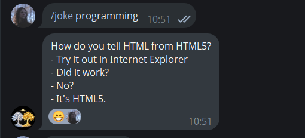

# Telegram Bot

Бот на Node.js + Hono: погода, курс валют, шутки (JokeAPI), фото собак.

## Демо: `/joke`

Команда `/joke` — случайная шутка; с аргументом — шутка из категории (`/joke programming`).

