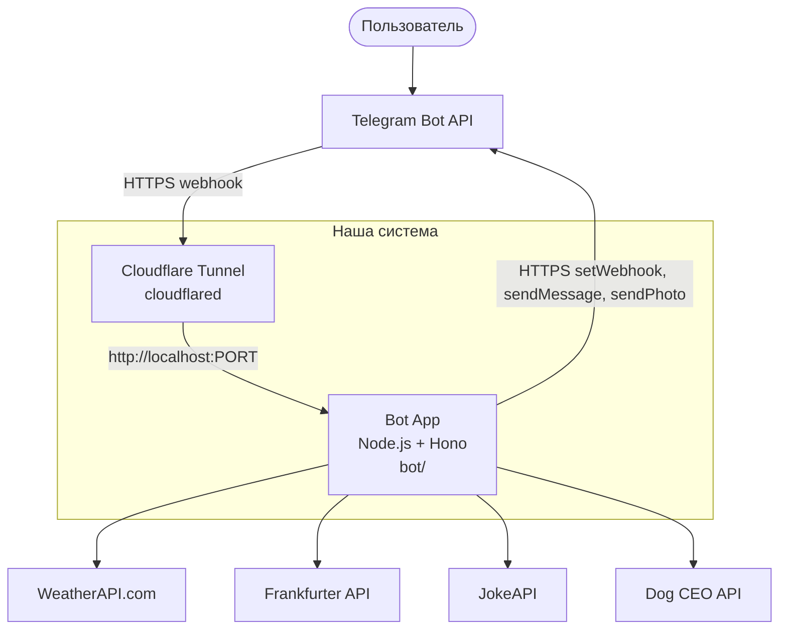

# Контейнеры

Рантайм: один локальный Node-процесс за Cloudflare Tunnel. Внешние системы — не наши контейнеры.

## Замечания

- `bot/` — один деплой/процесс (`pnpm start`), не дробим на микросервисы.
- Tunnel нужен только для локальной разработки (публичный HTTPS → localhost).
- Секреты: `token.mjs` (Telegram), `.env` (`WEBHOOK_URL`, `PORT`, `WEATHER_API_KEY`).
