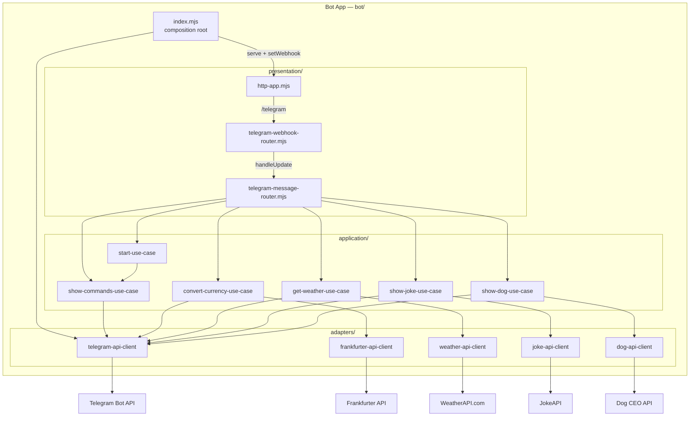

# Компоненты (Bot App)

Трёхслойная структура: `presentation` → `application` → `adapters`.

## Команды → use case

| Команда | Use case |
| ------- | -------- |
| `/start` | `startUseCase` (+ список команд) |
| `/convert` | `convertCurrencyUseCase` |
| `/weather` | `getWeatherUseCase` |
| `/joke` | `showJokeUseCase` |
| `/dog` | `showDogUseCase` |
| иное | `showCommandsUseCase` |
